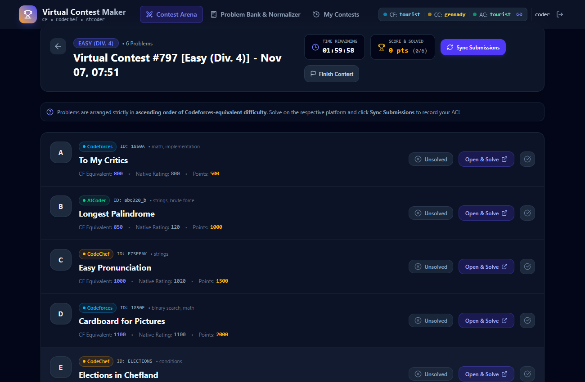
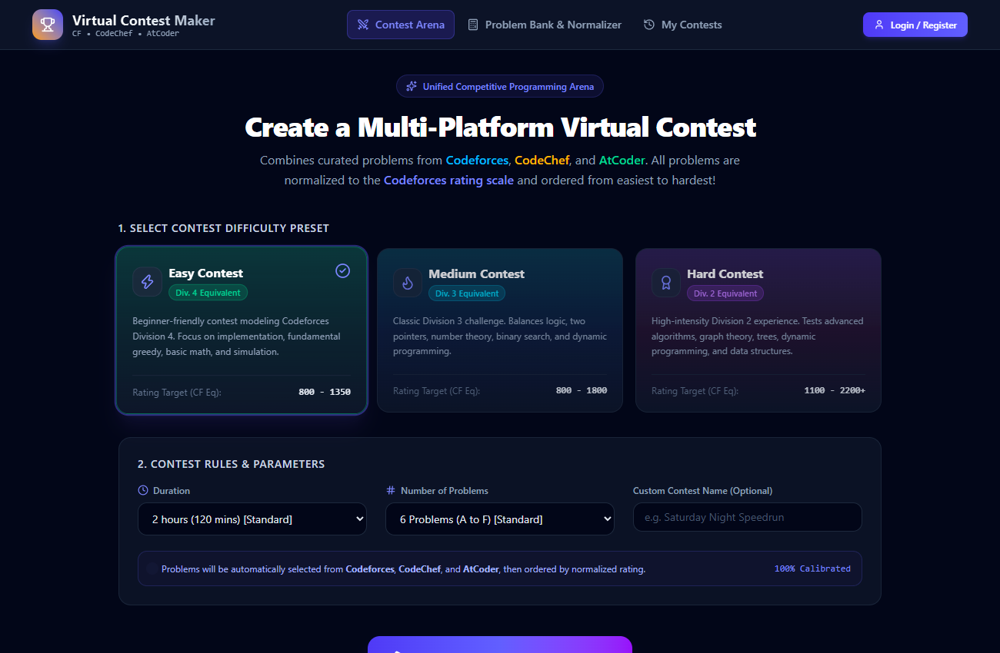
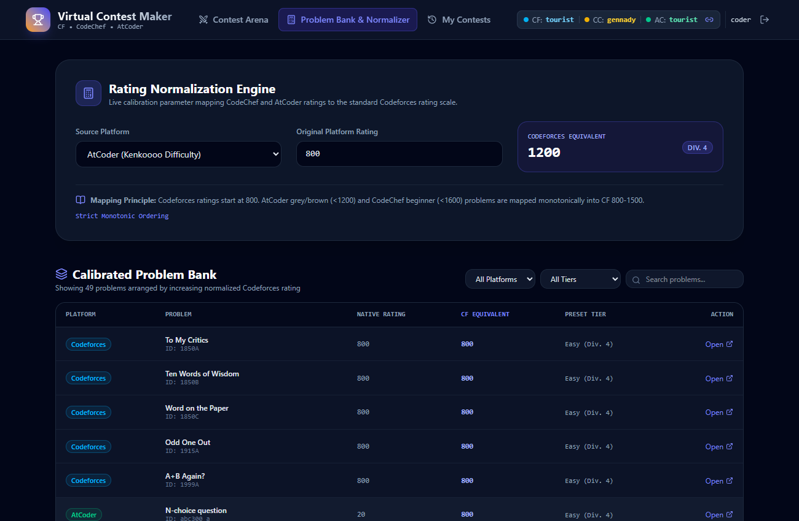
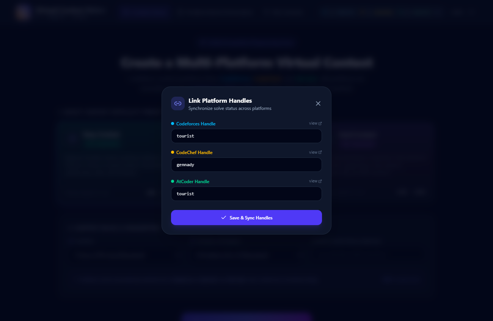

# Virtual Contest Maker (VCM)

[](https://github.com/dark-coder1211/Virtual-Contest-Maker)
[](https://www.djangoproject.com/)
[](https://www.django-rest-framework.org/)
[](https://react.dev/)
[](https://tailwindcss.com/)

A full-stack competitive programming contest aggregator built with **Django REST Framework** and **React**. It allows users to combine problems from **Codeforces**, **CodeChef**, and **AtCoder** into unified virtual contests, calibrating problem ratings to a single Codeforces standard and automatically verifying live solutions directly from each platform.

🔗 **Repository:** [https://github.com/dark-coder1211/Virtual-Contest-Maker](https://github.com/dark-coder1211/Virtual-Contest-Maker)

---

## 📸 Application Screenshots

### 1. Live Virtual Contest Arena
*Real-time countdown timer, multi-platform problem matrix sorted monotonically from A to F, live score tracker, and solve verification.*


---

### 2. Contest Creator & Division Presets
*Configurable virtual contest generator offering Easy (Div. 4), Medium (Div. 3), and Hard (Div. 2) Codeforces-equivalent divisions.*


---

### 3. Rating Normalization Engine & Problem Bank
*Interactive calculator and catalog showing native ratings mapped monotonically into Codeforces equivalents across all platforms.*


---

### 4. Multi-Platform Handle Synchronization
*Link Codeforces, CodeChef, and AtCoder handles for automated Accepted (AC) verdict polling and verification.*


---

## 🌟 Key Features

1. **Multi-Platform Contest Generation**:
   - Aggregates problems from **Codeforces**, **CodeChef**, and **AtCoder** into a single virtual contest.
   - Eliminates platform-hopping and provides a unified, distraction-free environment.

2. **Unified Rating Normalization**:
   - Converts native difficulty ratings from all platforms onto an equivalent **Codeforces rating scale**.
   - Questions in every virtual contest are strictly arranged in **increasing order of difficulty ($A, B, C, D, E, F\dots$)**.

3. **Preset Difficulty Divisions**:
   - **Easy Contest**: Codeforces **Div. 4** equivalent ($\sim 800 - 1350$ rating). Focuses on implementation, basic math, greedy, and simulation.
   - **Medium Contest**: Codeforces **Div. 3** equivalent ($\sim 800 - 1800$ rating). Balances binary search, DP, two pointers, and data structures.
   - **Hard Contest**: Codeforces **Div. 2** equivalent ($\sim 1100 - 2200+$ rating). Advanced challenge covering graph algorithms, trees, and advanced dynamic programming.

4. **Live Handle Solve Synchronization**:
   - Link your **Codeforces**, **CodeChef**, and **AtCoder** handles in your profile.
   - During contests, click **"Sync Submissions"** (or let background auto-sync run every 45s): VCM checks the respective platform APIs for **Accepted (AC)** submissions on contest problems and updates your score in real time.
   - Manual override toggle included for offline practice or platform downtime.

5. **Contest History & Score Tracking**:
   - Persistent contest history, points, solve counts, and performance breakdowns over time.

---

## 📐 Rating Normalization Formula

| Platform | Native Metric | Codeforces Equivalent Formula |
|---|---|---|
| **Codeforces** | Native problem rating (800 - 3500) | $\text{CF} = \text{Rating}$ (Baseline Standard) |
| **AtCoder** | Kenkoooo difficulty (0 - 2400) | $\le 400 \implies 800 + (\text{diff}/400) \times 150$<br>$400 - 1200 \implies 950 + ((\text{diff}-400)/800) \times 550$<br>$1200 - 2000 \implies 1500 + ((\text{diff}-1200)/800) \times 500$<br>$> 2000 \implies 2000 + (\text{diff}-2000) \times 1.05$ |
| **CodeChef** | Problem rating (500 - 2500) | $\le 1000 \implies 800 + (\text{diff}/1000) \times 200$<br>$1000 - 1600 \implies 1000 + ((\text{diff}-1000)/600) \times 450$<br>$1600 - 2200 \implies 1450 + ((\text{diff}-1600)/600) \times 500$<br>$> 2200 \implies 1950 + (\text{diff}-2200) \times 0.95$ |

---

## 🚀 Quick Start Guide

### 1. Backend Setup (Django REST Framework)

```bash
# 1. Activate virtual environment
.\venv\Scripts\activate   # Windows
# source venv/bin/activate # Linux / macOS

# 2. Navigate to backend
cd backend

# 3. Run database migrations & seed problems
python manage.py migrate
python manage.py seed_problems

# 4. Start backend server
python manage.py runserver 127.0.0.1:8000
```

> **Demo User Account**:
> - **Username**: `coder`
> - **Password**: `coder123`
> *(Or register a new account instantly through the UI!)*

---

### 2. Frontend Setup (React + Vite + Tailwind CSS)

```bash
# 1. Navigate to frontend
cd frontend

# 2. Install dependencies
npm install

# 3. Start development server
npm run dev
```

Visit **`http://localhost:5173`** in your browser.

---

## 🛠 API Endpoints Reference

### Authentication (`/api/auth/`)
- `POST /api/auth/register/` - Register account with optional CP handles.
- `POST /api/auth/login/` - Login & obtain authentication token.
- `GET /api/auth/me/` - Retrieve user profile and linked handles.
- `PATCH /api/auth/me/` - Update Codeforces, CodeChef, and AtCoder handles.

### Problems & Normalizer (`/api/problems/`)
- `GET /api/problems/` - List all problems sorted by `normalized_cf_rating`.
- `POST /api/problems/convert-rating/` - Real-time rating conversion tool.
- `POST /api/problems/fetch-external/` - Sync fresh problems from Codeforces API.

### Contests (`/api/contests/`)
- `POST /api/contests/create/` - Create a virtual contest (`EASY`, `MEDIUM`, or `HARD`).
- `GET /api/contests/participations/<id>/` - Retrieve live contest participation status.
- `POST /api/contests/participations/<id>/sync/` - Query CF, CC, and AC to verify AC solves.
- `POST /api/contests/participations/<id>/finish/` - Complete contest.
- `POST /api/contests/participations/<id>/manual-mark/` - Manual solve verification toggle.
- `GET /api/contests/history/` - Retrieve user's past contest history.
